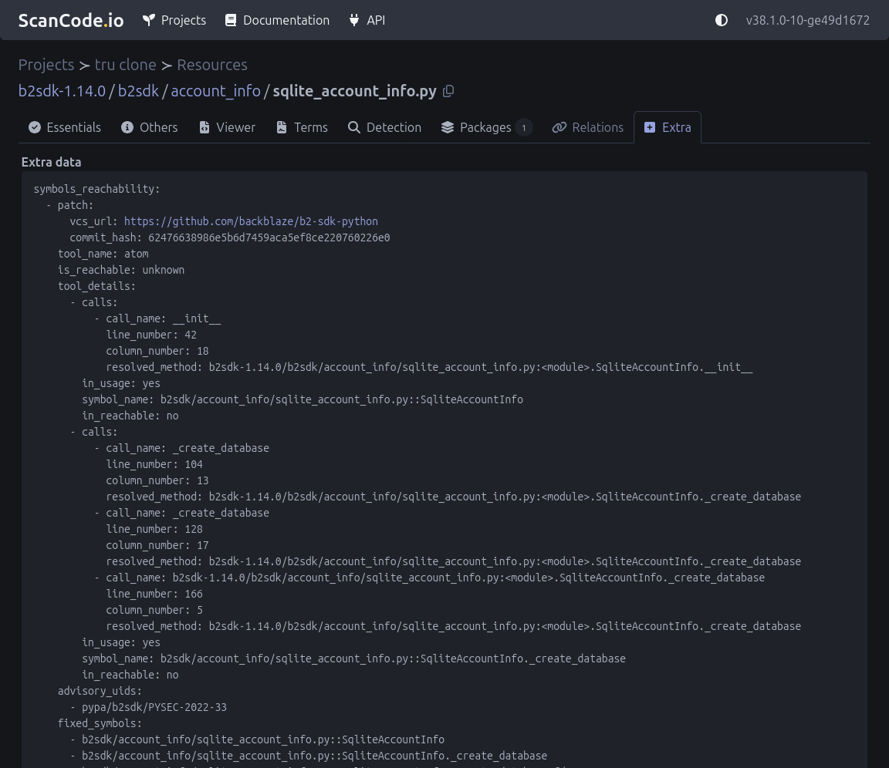

.. _tutorial_atom_reachability_integration_tools:

Atom Reachability Tools
========================

The ``atom_reachability`` pipeline uses
`Atom <https://github.com/AppThreat/atom>`_ to determine whether code symbols
referenced by a vulnerability patch are reachable. Atom is run twice against
the project codebase:

- ``usages`` extracts local variable and parameter usages from the code and
  writes a ``.atom`` file plus a ``usages`` slice.
- ``reachables`` reads that ``.atom`` file and writes a ``reachables`` slice
  of the symbols that can actually be reached, based on automatically
  generated framework tags.

Each advisory is classified as ``yes``, ``unknown``, or ``no``.

Requirements
------------

- `Atom tool <https://github.com/AppThreat/atom>`_ installed and configured.

Configuration
-------------

Set this environment variable in your ``.env``:

.. code-block:: bash

    ATOM_EXECUTABLE="/home/user/.npm-global/bin/atom"

Running the pipeline
--------------------

1. Open a Project that contains resources and at least one package
   vulnerability.
2. Click **"Add pipeline"** and select **"atom_reachability"**.
3. Select **"Execute pipeline now"** and click **"Add pipeline"**.
4. After completion, open the **Resources** view (click the count under
   **"RESOURCES"**), then click an affected file and open the **Extra**
   tab to view the ``symbols_reachability`` data.

Output
------

The pipeline writes four timestamped files three JSON documents and one
binary atom file and embeds the same advisory data in each resource's
``extra_data.symbols_reachability``.

1. ``reachability-YYYY-MM-DD-HH-MM-SS.json`` is the advisory reachability
   report. It aggregates results per advisory, listing each advisory with
   its overall verdict, matched vulnerable/fixed symbols, and per-symbol
   witness paths.
   Schema:

.. code-block:: json
    :emphasize-lines: 2, 7, 9, 13

    {
      "purl": "pkg:pypi/b2sdk@1.14.0",
      "advisories": [
        {
          "advisory_uid": "pypa/b2sdk/PYSEC-2022-33",
          "is_reachable": "yes",
          "details": [
            {
              "symbol_name": "SqliteAccountInfo._create_database",
              "in_usage": true,
              "calls": [],
              "in_reachable": true
            }
          ],
          "vulnerable_symbols": [
            "b2sdk/account_info/sqlite_account_info.py::SqliteAccountInfo",
            "b2sdk/account_info/sqlite_account_info.py::SqliteAccountInfo._create_database",
          ],
          "fixed_symbols": [
            "b2sdk/account_info/sqlite_account_info.py::SqliteAccountInfo",
            "b2sdk/account_info/sqlite_account_info.py::SqliteAccountInfo._create_database",
          ]
        }
      ]
    }

2. ``atom_reachability-YYYY-MM-DD-HH-MM-SS.python.usages.slices.json`` is the
   ``usages`` slice generated by atom.

.. code-block:: text

    {
      "objectSlices": [...],
      "userDefinedTypes": [...]
    }

3. ``atom_reachability-YYYY-MM-DD-HH-MM-SS.python.reachables.slices.json`` is
   the ``reachables`` slice generated by atom.

.. code-block:: text

    [
      {
        "flows": [
        ...
        ],
        "purls": []
      },
      ...
    ]

4. ``atom_reachability-YYYY-MM-DD-HH-MM-SS.python.atom`` is atom's binary
   CPG. It can be re-sliced, exported to other tools,
   and queried with graph algorithms using the atom CLI.
