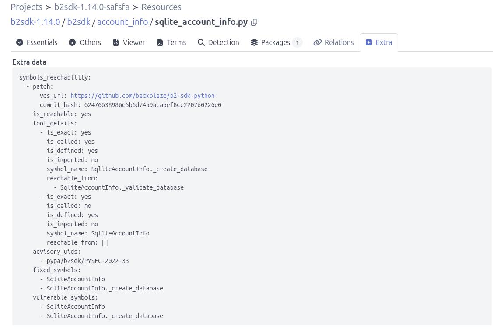

.. _tutorial_cpg_reachability_integration_tools:

CPG Reachability Tools
======================

The ``cpg_reachability`` pipeline uses a
`Code Property Graph (CPG) <https://github.com/Fraunhofer-AISEC/cpg>`_ to
determine whether code symbols referenced by a vulnerability patch are
reachable from a public entry point in your codebase. Each advisory is
classified as ``yes``, ``unknown``, or ``no``.

Requirements
------------

- `Fraunhofer CPG CLI <https://github.com/Fraunhofer-AISEC/cpg>`_ installed
  and on ``PATH``.
- A running Neo4j instance with the APOC plugin:

.. code-block:: console

    docker run -d --name neo4j \
      -p 7474:7474 -p 7687:7687 \
      -e NEO4J_AUTH=neo4j/password \
      -e NEO4J_PLUGINS='["apoc"]' \
      -e NEO4J_server_memory_heap_max__size=6g \
      -e NEO4J_server_memory_pagecache_size=1g \
      neo4j:5

Configuration
-------------

Set these environment variables in your ``.env``:

================================ ================= ===========================================
Variable                         Default           Purpose
================================ ================= ===========================================
``CPG_NEO4J_HOST``             ``localhost``   Neo4j Bolt host
``CPG_NEO4J_PORT``             ``7687``        Neo4j Bolt port
``CPG_NEO4J_USER``             ``neo4j``      Neo4j username
``CPG_NEO4J_PASSWORD``         ``password``    Neo4j password
``CPG_NEO4J_EXECUTABLE``       (none)            Path to the ``cpg`` CLI
================================ ================= ===========================================

Running the pipeline
--------------------

1. Open a Project that contains resources and at least one package
   vulnerability.
2. Click **"Add pipeline"** and select **"cpg_reachability"**.
3. Select **"Execute pipeline now"** and click **"Add pipeline"**.
4. After completion, open the **Resources** view (click the count under
   **"RESOURCES"**), then click an affected file and open the **Extra**
   tab to view the ``symbols_reachability`` data.

Output
------

The pipeline writes two timestamped JSON reports and embeds the same
advisory data in each resource's ``extra_data.symbols_reachability``.

1. ``reachability-YYYY-MM-DD-HH-MM-SS.json`` — the advisory reachability
   report. Aggregates results per package (``purl``), listing each
   advisory with its overall verdict, matched vulnerable/fixed symbols,
   and per-symbol witness paths. Schema:

.. code-block:: json
    :emphasize-lines: 2, 7, 9, 13

    {
      "purl": "pkg:pypi/b2sdk@1.14.0",
      "advisories": [
        {
          "advisory_uid": "pypa/b2sdk/PYSEC-2022-33",
          "is_reachable": "yes",
          "details": [
            {
              "symbol_name": "SqliteAccountInfo._create_database",
              "is_defined": true,
              "is_reachable": true,
              "eog_path": [
                "b2sdk.scan_folder",
                "b2sdk.LocalSyncFolder._get_folder",
                "SqliteAccountInfo._create_database"
              ]
            }
          ],
          "vulnerable_symbols": [
            "SqliteAccountInfo",
            "SqliteAccountInfo._create_database"
          ],
          "fixed_symbols": [
            "SqliteAccountInfo",
            "SqliteAccountInfo._create_database"
          ]
        }
      ]
    }

2. ``cpg_reachability-YYYY-MM-DD-HH-MM-SS.json`` — the matched subgraph
   extracted from Neo4j, serialized as a node/edge document. Contains
   the entry points, the matched symbols, and every node and edge on
   the witness paths, so the reachability verdict can be re-inspected
   or visualized offline without a live Neo4j instance. Schema:

.. code-block:: json

    {
       "nodes": [...],
       "edges": [...]
    }
